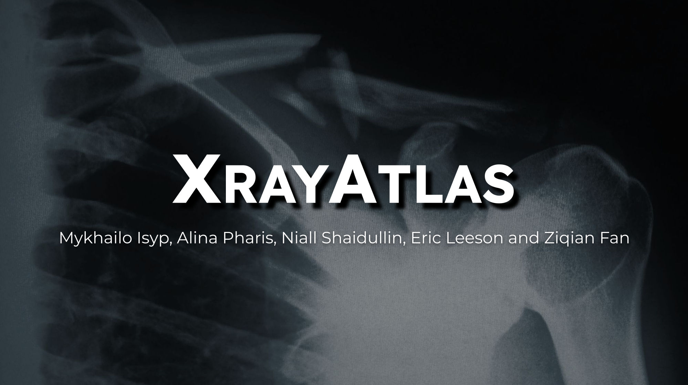

# XrayAtlas: Automated X-Ray Classification and Registration

XrayAtlas is a Python-based computer vision and machine learning application developed as part of CMPT 419: Biomedical Image Computing at Simon Fraser University.

The project combines convolutional neural network (CNN) classification with image registration to identify anatomical regions in X-ray images and visualize them on a full-body anatomical template.

Developed collaboratively as an undergraduate group project, XrayAtlas explores the potential and limitations of integrating deep learning and image processing into automated medical imaging workflows.

**Course:** CMPT 419 – Biomedical Image Computing  
**Institution:** Simon Fraser University  
**Date:** Spring 2025  
**Project Type:** Undergraduate group project

## Project Overview

Medical imaging workflows often involve large collections of images that require identification, classification, and alignment.

XrayAtlas was developed to investigate two components of this process:

1. **Image Classification:** Using machine learning to identify anatomical regions represented in X-ray images.
2. **Image Registration:** Aligning classified X-ray images with a full-body anatomical template for visualization and analysis.

The project integrates these components into a Python-based application, demonstrating how machine learning and traditional image processing methods can be combined within a single workflow.

## Project Report

📄 **[Read the Full XrayAtlas Project Report](XrayAtlas_report.pdf)**

The report documents the project's methodology, implementation, experimental results, technical challenges, and individual team contributions.

The final classification model achieved:

- **Validation accuracy:** 77.8%
- **Training accuracy:** 99.2%

The difference between training and validation performance highlighted challenges with overfitting and generalization, which were investigated throughout model development.

## Project Demo

[](https://youtu.be/61XbSw7Ck1A)

[](https://youtu.be/61XbSw7Ck1A)

## Technical Methods

### X-Ray Image Classification

The classification component uses convolutional neural networks (CNNs) to predict anatomical regions from X-ray images.

Techniques implemented and evaluated include:

- Image preprocessing, resizing, and normalization
- Multi-label classification of anatomical regions
- Data augmentation through rotation, translation, and zoom transformations
- Model training using TensorFlow/Keras
- Batch normalization and dropout regularization
- Class weighting to address imbalanced training data
- Multiphase training and hyperparameter optimization
- Classification performance evaluation

### Image Registration

The registration component aligns classified X-ray images with a standardized full-body anatomical template.

The workflow uses predicted anatomical labels to identify the appropriate region of the template before performing image registration.

Techniques used in the registration component include:

- Anatomical region identification and template mapping
- Image alignment using similarity transformations
- Mutual information as an image registration objective
- Multiresolution optimization
- Image blending and visualization

The registration process produced promising results for certain anatomical regions but encountered limitations when handling images with varying orientations and anatomical proportions.

These challenges highlighted the complexity of image registration and the limitations of using a fixed two-dimensional anatomical template.

## My Contributions

My primary responsibility within the XrayAtlas team was developing and improving the X-ray classification component.

Building upon the initial classification implementation, I focused on improving model performance, training stability, and generalization.

My contributions included:

- **CNN Architecture:** Added batch normalization layers after convolutional layers and restructured dropout implementation to improve training stability and reduce overfitting.
- **Data Augmentation:** Implemented controlled image rotations (±10°), translations (±10%), and zoom transformations (±10%) to improve model generalization.
- **Handling Class Imbalance:** Implemented class weighting to account for uneven representation of anatomical regions in the training dataset.
- **Multi-Label Classification:** Developed a 1-of-K encoding approach to accommodate X-ray images containing multiple anatomical regions.
- **Training Optimization:** Introduced a multiphase training strategy and modified model parameters to improve training efficiency and classification performance.
- **Research Documentation:** Contributed to the written project report, particularly the classification methodology, preprocessing, model architecture, training strategies, and dataset characteristics.

Together, these improvements increased classification accuracy by more than five percentage points compared with the initial implementation.

This work provided practical experience investigating the limitations of machine learning models, refining computational methods, and evaluating their performance on complex real-world image data.

## Technologies

- **Programming:** Python
- **Machine Learning:** TensorFlow / Keras, convolutional neural networks
- **Image Processing:** OpenCV, image registration, classification, preprocessing
- **Development:** Jupyter Notebook, Conda, Git/GitHub
- **Dataset:** UNIFESP X-ray Body Part Classifier dataset

## Repository Structure

```text
XrayAtlas/
├── src/                    # Source code
├── Classification.ipynb   # Classification notebook
├── images/                 # Project screenshots
├── predict_image_here/     # Sample image input directory
├── main.py                 # Application entry point
├── requirements.yml        # Conda environment
├── XrayAtlas_report.pdf    # Full project report
└── README.md               # Project documentation
```

## Installation

### 1. Clone the repository

```bash
git clone https://github.com/asage101/XrayAtlas.git
cd XrayAtlas
```

### 2. Create the Conda environment

```bash
conda env create -f requirements.yml
conda activate xray_atlas
```

### 3. Download the dataset

The classification component uses the [UNIFESP X-ray Body Part Classifier dataset](https://www.kaggle.com/competitions/unifesp-x-ray-body-part-classifier/data).

Install and configure the Kaggle API, accept the dataset's access requirements, and download the data:

```bash
mkdir data
kaggle competitions download -c unifesp-x-ray-body-part-classifier -p data
```

Extract the downloaded archive into the directory expected by the application.

## Running the Application

Place a supported sample X-ray image in the `predict_image_here` directory.

Run:

```bash
python main.py --input ./predict_image_here/sample.png
```

The application processes the input image through the implemented classification and registration workflow.

## Limitations and Future Development

Although XrayAtlas demonstrated the feasibility of combining CNN-based classification with image registration, several limitations were identified.

- **Model Generalization:** A substantial difference between training and validation accuracy suggested overfitting and possible dataset biases.
- **Registration Accuracy:** Registration performance varied between anatomical regions, particularly when X-ray orientation differed from the reference template.
- **Template Limitations:** The fixed two-dimensional anatomical template limited the ability to accommodate differences in anatomical proportions and orientation.
- **Dataset Dependence:** The classification system was developed using a specific X-ray dataset, limiting conclusions about performance on other datasets.

Potential future improvements include expanding the training data, refining model regularization, developing more adaptable anatomical templates, and incorporating confidence scores into the visualization system.

## Academic Context and Contributors

XrayAtlas was developed collaboratively as an undergraduate group project for CMPT 419: Biomedical Image Computing at Simon Fraser University in Spring 2025.

**Original Project Contributors:**
- Mykhailo Isyp
- Alina Pharis
- Niall Shaidullin
- Eric Leeson
- Ziqian Fan

The project combined individual contributions in image classification, image registration, data preprocessing, visualization, and application integration.

This repository is maintained as a portfolio showcase of my academic work. My individual contributions are described above and documented in the full project report.

## Further Information

- [Full Project Report](XrayAtlas_report.pdf)
- [Project Demonstration on YouTube](https://youtu.be/61XbSw7Ck1A)
- [UNIFESP X-ray Body Part Classifier Dataset](https://www.kaggle.com/competitions/unifesp-x-ray-body-part-classifier/data)
